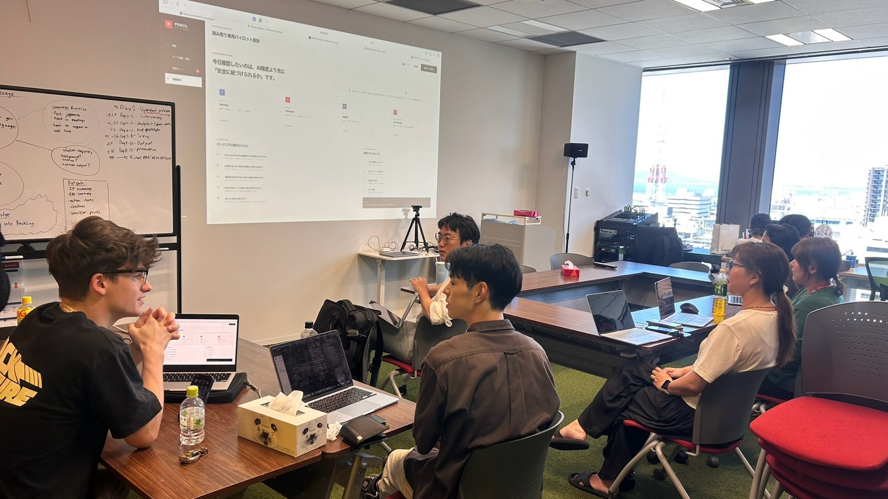
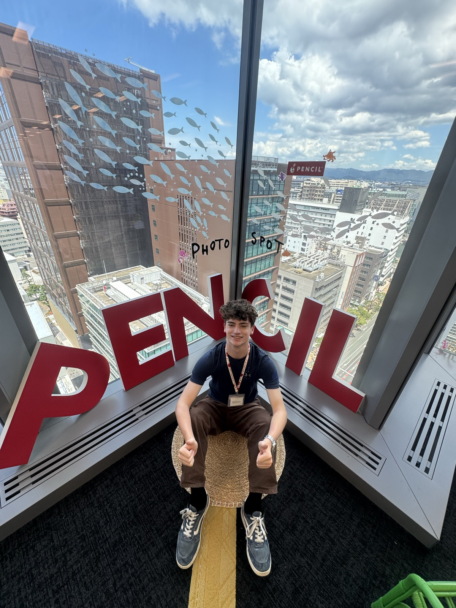
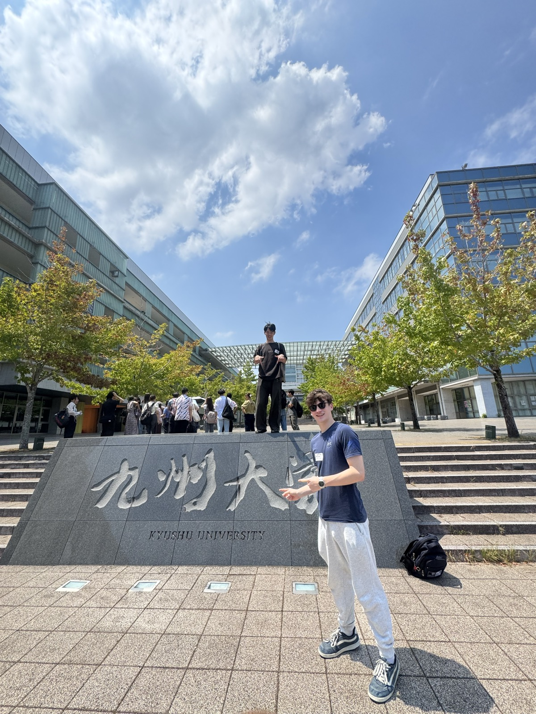
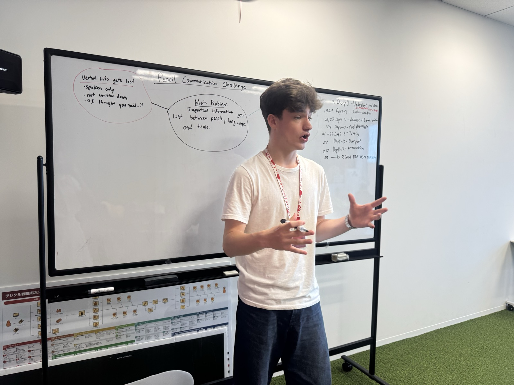
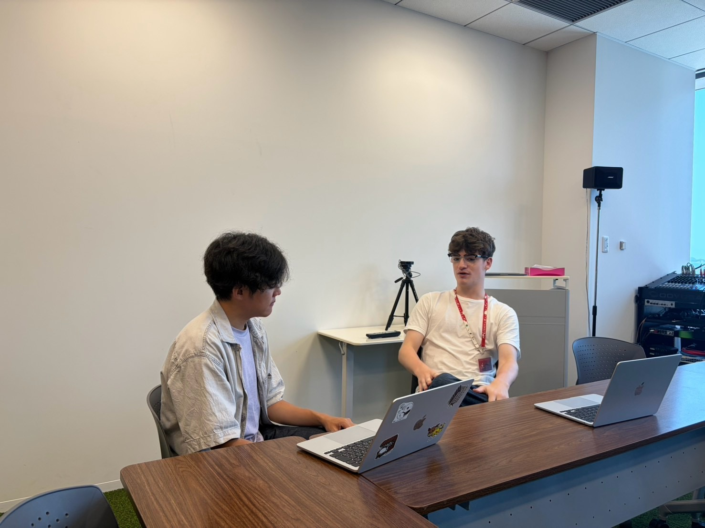
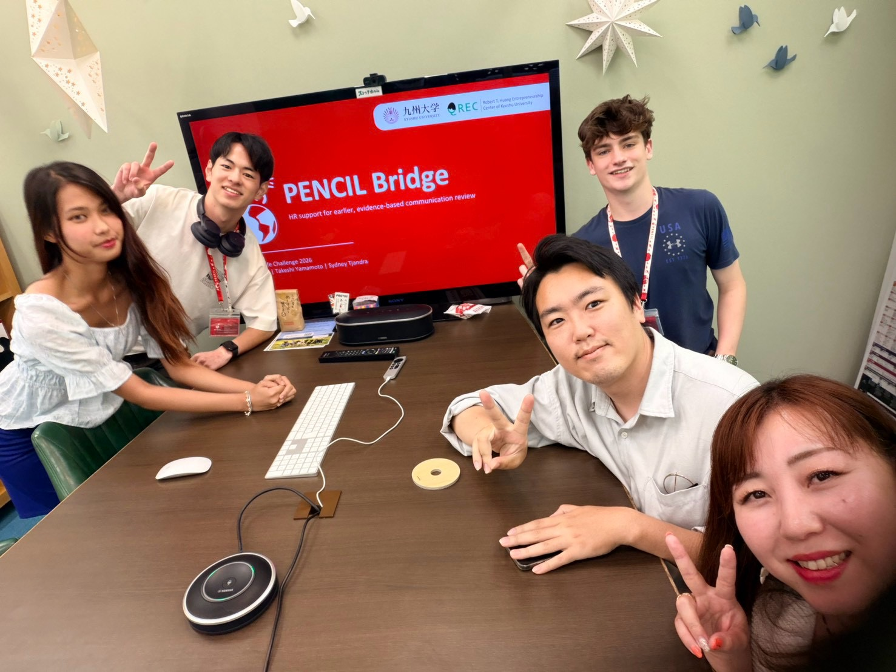
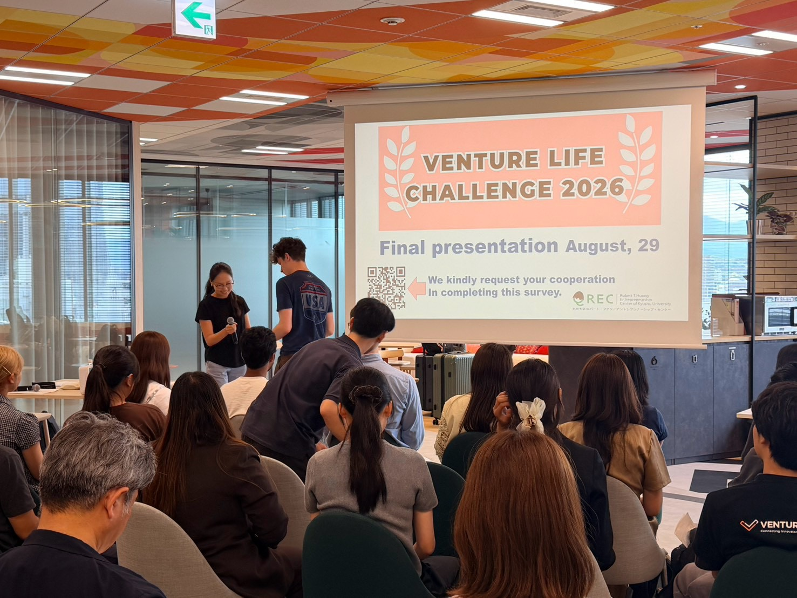
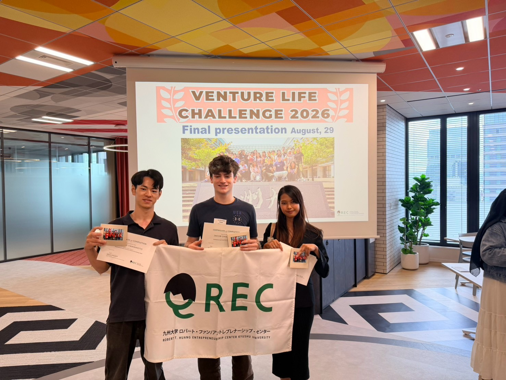

# PENCIL Bridge: what we built in 10 days

**Employee interviews, a bilingual prototype and a final presentation — built with feedback from PENCIL’s HR and engineering teams.**

I spent 10 days working on PENCIL Bridge with **Takeshi Yamamoto** and **Sydney Magnolia Tjandra**, during our placement at **PENCIL Co., Ltd. in Fukuoka** through Kyushu University’s **QREC Venture Life Challenge 2026**. I led the prototype and demo development, alongside product direction and the technical delivery.

*Working with PENCIL’s internal engineering division, two HR supervisors and an engineering director. We brought the prototype into the discussion so we could work through how it would fit the company’s workflows.*

[Try the bilingual demo](https://pencil-people-bridge.vercel.app) · [Technical walkthrough](../README.md#architecture) · [Internship record](PROJECT_ARCHIVE.md)

## Why I went to Fukuoka

I am usually based in Kansai, and I wanted to spend my summer break getting hands-on experience somewhere new. Fukuoka gave me the chance to meet people outside my usual circle and work on a problem inside a company.

PENCIL’s office stood out to me straight away. It was creative and open, and I enjoyed seeing engineers and consultants work closely together. I was excited that we could interview people, test ideas and build something during the placement.

<table>
<tr>
<td width="50%"></td>
<td width="50%"></td>
</tr>
<tr>
<td>At PENCIL in Fukuoka.</td>
<td>At Kyushu University during Venture Life Challenge.</td>
</tr>
</table>

Outside work, I enjoyed getting to know Fukuoka’s startup community. People were welcoming, and I also spent part of the trip moving between capsule hotels to keep it affordable. Those were some of the first impressions I shared on LinkedIn while I was there.

## Starting with the people doing the work

Our challenge was to understand an organisational problem involving a growing, diverse workforce and changes in how people work with AI. Before deciding what to build, we needed to hear how communication worked inside the company.

Our final presentation recorded **10 interviews** across HR, management, consultants and engineers, including Japanese and international employees. We looked at where information was shared, what happened when instructions were unclear, and how HR learned about a problem after it had developed.

A recurring issue was that the history of a decision could be spread across several places: a meeting, a Chatwork thread, a Backlog issue, a document in Box, or a verbal conversation. Someone investigating later might have the outcome but not the context that led to it.

*Working through the problem on the whiteboard: important information getting lost between people, languages and tools.*

That gave us a more specific question to work on: could we bring the relevant records together around an issue, show what might need clarification, and help HR follow up earlier?

## Choosing a focused product

We considered three early directions and took them to HR for feedback. The direction ranked first was organising issues between employees, managers and HR. Communication support based on needs someone had explicitly stated was also useful, but the first step was to make the situation easier to understand.

We narrowed the prototype to **HR-only review of work issues**. A finding would point back to source records and offer a neutral question to clarify. It would not score an employee, infer their personality or health, or make an employment decision.

That decision affected the interface as well as the analysis. We grouped records around a piece of work, kept the evidence visible, and separated private HR analysis from a clarification draft that would need human approval before being shared.

## Building with Takeshi and Sydney

We brought different skills to the project. I led the prototype, product direction, demo and technical delivery. Takeshi worked on employee research, engineering support, subtitles and presentation delivery. Sydney worked on design, filming, the financial presentation and presentation delivery. The final deck described our lead roles as product and prototype, user research and systems engineering, and business strategy and impact.

*A working session during the placement, with the project open on our laptops.*

There was a lot to fit into the build: understanding the interviews, choosing the scope, implementing the demonstration, getting feedback and preparing a presentation that explained both the product and the business case. The research, software and presentation had to stay connected as the idea changed.

*With company colleagues at PENCIL, with our project presentation on screen.*

## Bringing the prototype to HR and engineering

The review with the internal engineering division, two HR supervisors and an engineering director was an important part of the process. We had to explain how the idea would work with existing records and what HR would actually see.

The final deck records three areas where engineering feedback made the design more practical:

| Feedback area | What we worked towards |
| --- | --- |
| Information across tools | Link related Chatwork, Backlog and meeting records around the same issue, so the reviewer can follow the evidence. |
| HR visibility | Prepare a weekly summary and prioritised review candidates, rather than relying only on someone opening a dashboard. |
| Reasons behind a finding | Show why something was flagged, retain the source evidence and leave the final judgement with HR. |

The public prototype demonstrates those ideas using fictional records and simulated delivery. It does not connect to the company’s live systems. The engineering work included deciding what could be demonstrated during the placement and what would need approval, integration and evaluation later.

## What we could demonstrate

By the final presentation, we could show a local data-to-detection flow and a simulated HR review workflow. The example data contained **10 fictional work issues and 40 source records**, representing Backlog, Chatwork, meeting notes and Box.

The demonstration covered:

- Loading and storing fictional cases in browser-local IndexedDB.
- Detecting conflicting instructions, undocumented verbal decisions, rework signals, and acknowledgement followed by clarification.
- Returning findings with source references and neutral follow-up questions.
- Reviewing seeded cases, marking them reviewed, moving them to follow-up or dismissing a false positive.
- Keeping private HR analysis separate from a staff-facing clarification draft.
- Switching between **Japanese and English**.
- Exporting review data as CSV and showing a simulated weekly report and delivery state.

The detection lab and the seeded review queue are separate demonstration flows. New findings do not automatically enter the queue. Review states reset when the page reloads, while the detection lab retains its sample cases in IndexedDB. These details matter when someone tries the demo and follows the code.

### Inside the implementation

The repository uses **Next.js, React and TypeScript**. The detection API accepts bounded requests, applies deterministic rules and can optionally use a local Ollama model for semantic contradiction checking. The deterministic path runs without an external AI service.

The interface presents each signal as something to review, with the original evidence available. A reviewer can inspect the records and decide whether a follow-up is useful. There are no employee rankings or automatic personnel decisions.

Live workplace connectors, production authentication, access control, approved retention and external notification delivery remain outside the prototype. The [architecture and setup instructions](../README.md#architecture) explain the current implementation, and the [system-design alignment](system-design-alignment.md) records the work needed beyond the demonstration.

## Presenting what we had built

Our final presentation was on **August 29, 2026, at PwC Consulting in Fukuoka**. We prepared an approximately eight-minute presentation followed by five minutes of questions. The demo video had subtitles so it did not depend on everyone being able to hear the room audio.

I handled the opening, demo introduction and transition, then the financials, roadmap, team and conclusion. Sydney presented the company context, HR challenge, validation and engineer feedback. Takeshi presented the interviews and focused features.

*At the Venture Life Challenge final presentation on August 29.*

We also presented a financial planning case: **150 hours of annual HR capacity**, valued at **¥3,000 per hour**, giving **¥450,000 of estimated annual value** against a **¥150,000 investment assumption**. The resulting 3.0 benefit-cost ratio, approximately 200% ROI and four-month payback were modelled estimates. We had not measured those savings through a company rollout.

The stronger result from the placement was something we could actually show: interviews translated into a defined product, a working demonstration, a review with company staff, and a plan for what to test next.

## Finishing the program together

*Our team with the QREC banner and completion certificates at the end of the program.*

The ten-day build brought research, product decisions, implementation and presentation together. I was responsible for getting the prototype and demo working, but the direction came from the interviews, our team’s work and the feedback we received inside PENCIL.

It is the kind of work I wanted to experience when I came to Fukuoka: understand a problem with the people facing it, build something they can respond to, and use their feedback to make the next version more practical.

## What comes after the prototype

The next step would be a permission-reviewed pilot using approved or anonymised cases. Useful findings, false positives, HR review time and trust would need to be measured before expanding access or making claims about impact.

The broader internship is recorded as **August 17–29, 2026**. The ten days here describe the project build, rather than replacing the program dates. The current repository preserves the demonstration and technical documentation; it is a student internship prototype, not an official PENCIL product or a production HR system.

[Explore the code and full technical details](../README.md) · [Read the original project archive](PROJECT_ARCHIVE.md) · [Photo and story sources](media/README.md)
